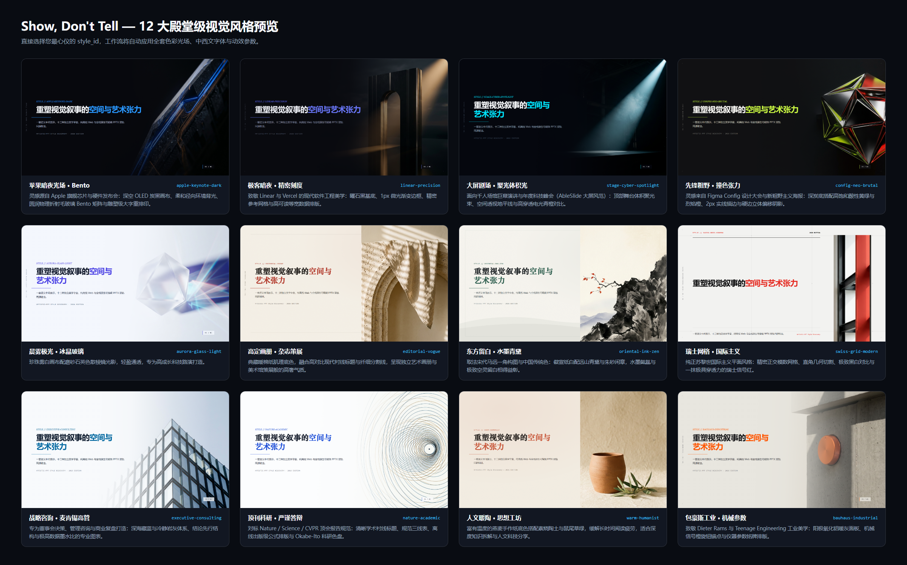
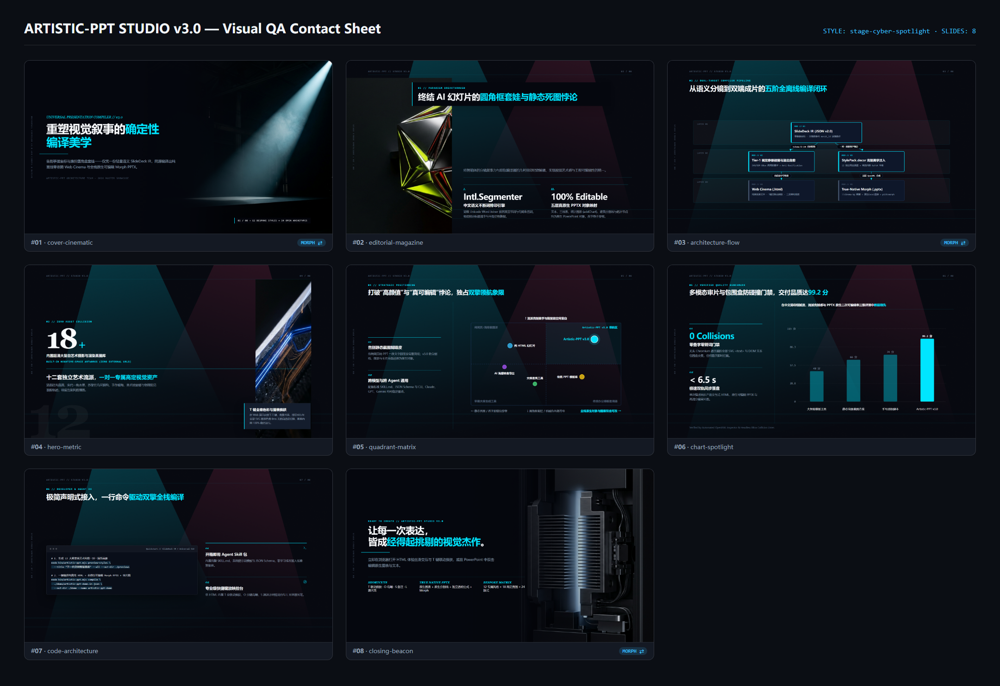
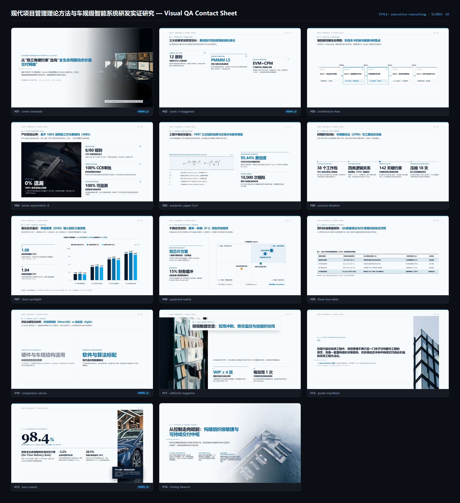
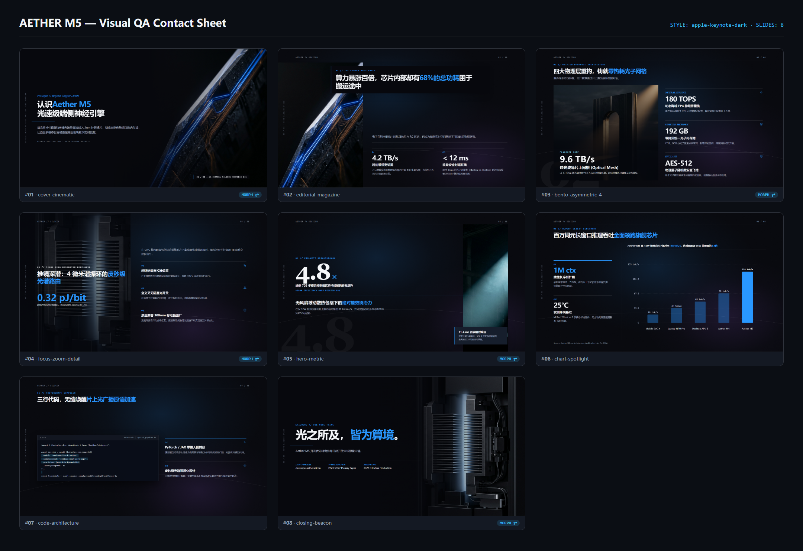
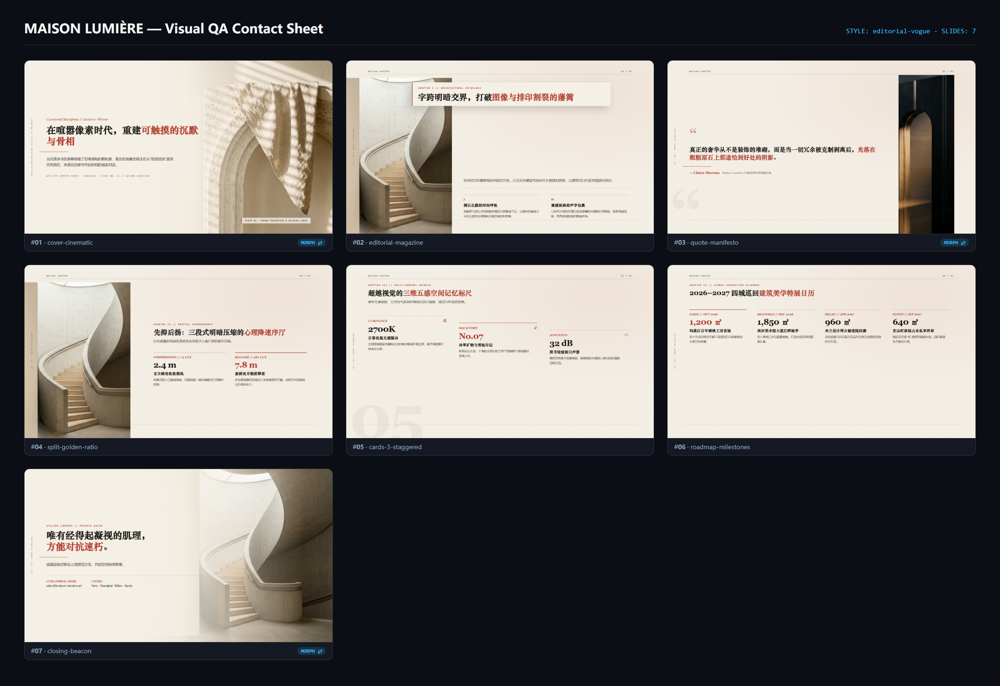
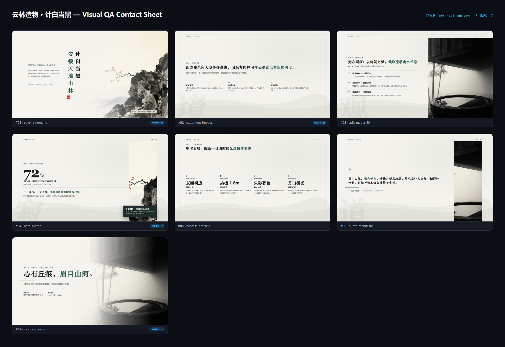
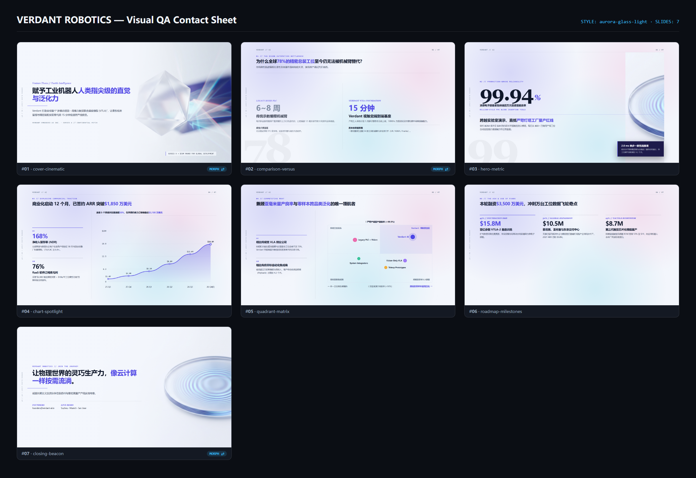
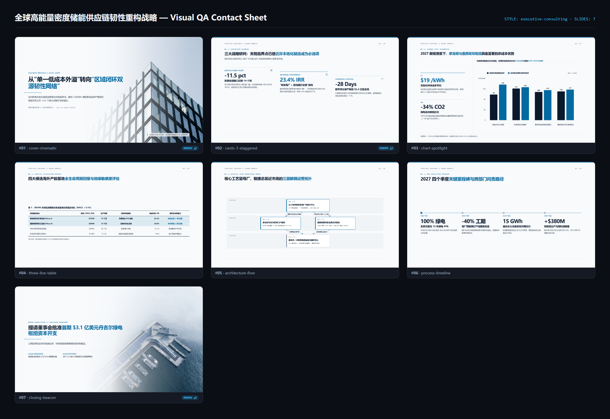
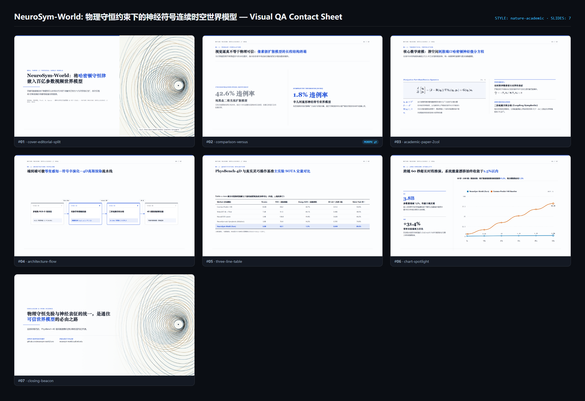
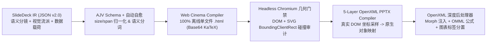

<div align="center">

# 🎨 Artistic-PPT Universal Workflow Studio (v3.1 Master Edition)

**跨模型、跨 Agent 通用的殿堂级艺术演示双擎编译系统**  
*Compile semantic `SlideDeck IR` into 100% Offline Web Cinema (`.html`) & 5-Layer True-Native Editable Morph PowerPoint (`.pptx`)*

[](https://github.com/tian-yu200/artistic-ppt-studio)
[](LICENSE)
[](tsconfig.json)
[](#双擎编译架构)
[](#五层全栈真原生-morph-pptx-架构)
[](#睁眼级视觉质检门禁)
[](SKILL.md)
[](https://afdian.com/a/artisticppt)

[核心特性](#-为什么选择-artistic-ppt-studio) •
[12 大艺术流派](#-12-大殿堂级视觉风格宇宙) •
[旗舰实战样板库](#visual-showcase) •
[五层原生 PPTX 架构](#-五层全栈真原生-morph-pptx-架构) •
[24 种版式原语](#-24-种高定版式原语-archetypes) •
[快速开始](#-命令行快速开始-cli) •
[跨 Agent 接入](#-跨-agent-与跨模型接入) •
[支持作者](#-支持作者)

</div>

---
## 支持作者
如果这个项目帮到了你，可以在爱发电支持我：[Artistic-PPT 视觉工坊 · afdian.com/a/artisticppt](https://afdian.com/a/artisticppt) —— 真原生全可编辑 PPT：Excel 图表、OMML 公式，竞赛答辩。

---

## 🌟 12 大殿堂级视觉风格宇宙 (`Show, Don't Tell`)

> 任何大模型（Claude / GPT / Gemini / Qwen / DeepSeek）只需输出一份轻量语义化的 `SlideDeck IR` JSON，即可在 **12 套独立美学宇宙** 与 **18 张内置 60%+ 负空间高定艺术真图** 之间一键编译或按 `T` 键实时无损换肤：



---

## 💡 为什么选择 Artistic-PPT Studio？

传统 AI 生成 PPT 长期困在**“好看的 HTML 转成 PPT 就是一张死图”**与**“能编辑的 PPTX 满屏 SaaS 圆角框套娃 + 文字重叠出框”**的二元悖论中。Artistic-PPT Studio v3.1 从编译器底层彻底终结这一悖论：

| 维度 | 传统 AI HTML 幻灯片 | 普通 PptxGenJS 脚本方案 | **Artistic-PPT Studio v3.1** |
| :--- | :--- | :--- | :--- |
| **视觉美学** | 依赖外部 Tailwind/Google Fonts，断网即崩 | 机械堆砌圆角矩形框（Box-in-Box 套娃） | **流派克制美学 (`StylePack.decor`) + 18 张高定负空间真图** |
| **中文排印** | 浏览器默认断行，标题常见末尾孤字 | 文本框宽度估算失准，频繁掉字或折行错位 | **`Intl.Segmenter` 中文语义分词 + `U+2060` 不断词保护 + 字号自愈** |
| **PPTX 可编辑性** | ❌ 整页截图贴入 PPT，完全无法改字 | ⚠️ 仅普通文字可改，图表/架构图全靠截图或简陋框线 | ✅ **五层全栈真原生 OpenXML：原生文本 + 矢量拓扑 + Excel 图表 + OMML 公式 + 三线表** |
| **丝滑转场动效** | 仅网页端 CSS 动画 | ❌ 翻页生硬切换 | ✅ **自动注入 `!!` 跨页同名锚点与 `<p159:morph option="byObject"/>` 原生平滑切换** |
| **复杂拓扑与图表** | 手写 SVG 极易节点叠字、连线穿卡 | 标签重叠、坐标轴 `General` 裸格式 | ✅ **4+ 层自适应卡片、双段外通道回环绕行曲线、高低序列标签自动分置 (`t`/`b`)** |
| **质检门禁** | 无质检，肉眼抽盲盒 | 仅校验 JSON 语法 | ✅ **无头 Chromium 真实 DOM/SVG `BoundingClientRect` 碰撞审计 + OpenXML 零缺陷核验** |

---

<a id="visual-showcase"></a>

## 🖼️ 旗舰实战样板库 (Visual Showcase)

所有样板均由同一套 `SlideDeck IR` **一键同源编译**产出纯离线 `.html`、全栈原生可编辑 `.pptx` 与高清审片矩阵 `.contact-sheet.png`，并通过本机 PowerPoint 1280×720 真实渲染复核。

### 1. 官方发布会级深色光场门面样板 (`stage-cyber-spotlight` · 8 Slides)
- **源码与成品**：[IR JSON](demo/artistic-ppt-demo.ir.json) ｜ [Web Cinema (.html)](demo/artistic-ppt-demo.html) ｜ [Native Morph (.pptx)](demo/artistic-ppt-demo.pptx)
- **涵盖版式**：`cover-cinematic`、`editorial-magazine`、`architecture-flow`、`hero-metric`、`quadrant-matrix`、`chart-spotlight`、`code-architecture`、`closing-beacon`



### 2. 14 页全量学术答辩与车规级系统工程实战长卷 (`executive-consulting` · 14 Slides)
- **源码与成品**：[IR JSON](demo/project-management-final.ir.json) ｜ [Web Cinema (.html)](demo/project-management-final.html) ｜ [Native Morph (.pptx)](demo/project-management-final.pptx)
- **亮点验证**：覆盖 5 阶段带跨层回环门径拓扑图、WBS 非对称 Bento 矩阵、PERT 贝塔分布原生 OMML 公式推导、CPM 关键路径、EVM 三序列分组柱状图、P-I 风险象限矩阵、顶刊三线表与 98.4% 巨物指标页。



### 3. 六大艺术流派专项样板矩阵 (`showcase/01..06`)

| 01 · 苹果暗夜光场 (`apple-keynote-dark`) | 02 · 高定杂志画册 (`editorial-vogue`) |
| :---: | :---: |
|  |  |
| [IR JSON](showcase/01-apple-keynote-dark/01-apple-keynote-dark.ir.json) · [HTML](showcase/01-apple-keynote-dark/01-apple-keynote-dark.html) · [PPTX](showcase/01-apple-keynote-dark/01-apple-keynote-dark.pptx) | [IR JSON](showcase/02-editorial-vogue/02-editorial-vogue.ir.json) · [HTML](showcase/02-editorial-vogue/02-editorial-vogue.html) · [PPTX](showcase/02-editorial-vogue/02-editorial-vogue.pptx) |
| **03 · 东方水墨留白 (`oriental-ink-zen`)** | **04 · 晨雾极光路演 (`aurora-glass-pitch`)** |
|  |  |
| [IR JSON](showcase/03-oriental-ink-zen/03-oriental-ink-zen.ir.json) · [HTML](showcase/03-oriental-ink-zen/03-oriental-ink-zen.html) · [PPTX](showcase/03-oriental-ink-zen/03-oriental-ink-zen.pptx) | [IR JSON](showcase/04-aurora-glass-pitch/04-aurora-glass-pitch.ir.json) · [HTML](showcase/04-aurora-glass-pitch/04-aurora-glass-pitch.html) · [PPTX](showcase/04-aurora-glass-pitch/04-aurora-glass-pitch.pptx) |
| **05 · 麦肯锡高管咨询 (`executive-consulting`)** | **06 · Nature 顶刊科研 (`nature-academic`)** |
|  |  |
| [IR JSON](showcase/05-executive-consulting/05-executive-consulting.ir.json) · [HTML](showcase/05-executive-consulting/05-executive-consulting.html) · [PPTX](showcase/05-executive-consulting/05-executive-consulting.pptx) | [IR JSON](showcase/06-nature-academic/06-nature-academic.ir.json) · [HTML](showcase/06-nature-academic/06-nature-academic.html) · [PPTX](showcase/06-nature-academic/06-nature-academic.pptx) |

---

## 🏗️ 五层全栈真原生 Morph PPTX 架构



我们在 `.pptx` 编译器中摒弃了粗暴的整页截图，构建了工业级 **五层全栈原生 OpenXML 映射管线**：

| 层级 | 名称 | OpenXML 底层实现 | 用户在 PowerPoint 中的二次编辑体验 |
| :---: | :--- | :--- | :--- |
| **Layer 0** | **纯净光影基底** | 隐藏全部文字、矢量线、卡片与前景图后仅采样环境光影与宣纸肌理 | 增删任何文字、移动任何卡片绝不露出残影或假死线 |
| **Layer 1** | **动态艺术画窗 (`!!cinema-bg`)** | 独立裁剪输出高定负空间真图 `<p:pic name="!!cinema-bg">`，注入 `<p159:morph option="byObject"/>` | 翻页自动触发 PowerPoint 原生平滑推轨、缩放与视差穿梭 |
| **Layer 2** | **原生矢量几何与拓扑 (`<p:sp>`)** | Bento 卡片、切口衬板、架构图节点、自定义贝塞尔路径 (`<a:custGeom>`) 与连线箭头全部为原生形状 | 每一个节点卡片、分割线、图标均可独立拖拽、改色、缩放 |
| **Layer 3** | **原生 Excel 图表与 OMML 公式** | 柱状/折线/环形图写入 `ppt/charts/chart*.xml`；LaTeX 公式编译为原生 Office Math (`<a14:m>`) | 右键图表直接**“编辑 Excel 数据”**；公式可直接在公式编辑器中改符号 |
| **Layer 4** | **精细行内富文本与顶刊三线表** | 独立保留行内单位 (`<em class="hm-unit">`) 字号/斜体/颜色；三线表精准控制顶底粗线与表头细线 | 100% 原生文本框（华文中宋 / 等线 / 微软雅黑），支持中式竖排 (`eaVert`) |

---

## 🎭 12 套艺术风格与 18 张内置高定真图速查

| `style_id` | 风格名称 | 调性 | 核心色彩特征 | 绑定内置高定艺术资产 (`assets/art-library/`) |
| :--- | :--- | :---: | :--- | :--- |
| `apple-keynote-dark` | 苹果暗夜光场 · Bento | 暗色 | 深空 OLED 炭黑 + 电光蓝/紫微光 | `silicon-wafer-macro.jpg` / `cnc-titanium-unibody.jpg` |
| `linear-precision` | 极客暗夜 · 精密刻度 | 暗色 | 曜石黑 + `1px` 渐变精密边框 | `cnc-titanium-unibody.jpg` / `silicon-wafer-macro.jpg` |
| `stage-cyber-spotlight` | 大屏剧场 · 聚光体积光 | 暗色 | 舞台体积聚光束 + 电光青橙对比 | `cyber-stage-spotlight.jpg` / `liquid-chrome-polyhedron.jpg` |
| `config-neo-brutal` | 先锋粗野 · 撞色张力 | 暗色 | 高饱和酸性黄绿 + `2px` 实线硬边阴影 | `liquid-chrome-polyhedron.jpg` |
| `aurora-glass-light` | 晨雾极光 · 冰晶玻璃 | 亮色 | 珍珠雾白 + 磨砂石英色散棱镜 | `dichroic-glass-prism.jpg` / `optical- wave-ribbons.jpg` |
| `editorial-vogue` | 高定画册 · 杂志策展 | 亮色 | 典藏暖棉纸 + 高对比现代衬线 | `travertine-linen-arch.jpg` / `gallery-spiral-stair.jpg` |
| `oriental-ink-zen` | 东方留白 · 水墨青黛 | 亮色 | 徽宣纸白 + 远山青黛 + 朱砂闲章 | `song-ink-mountain.jpg` / `misty-zen-courtyard.jpg` |
| `swiss-grid-modern` | 瑞士网格 · 国际主义 | 亮色 | 正交模数网格 + 黑白对比 + 瑞士信号红 | `swiss-brutalist-facade.jpg` |
| `executive-consulting` | 战略咨询 · 麦肯锡高管 | 亮色 | 深海藏蓝 + 冷静岩灰 + 结论先行结构 | `cobalt-glass-architecture.jpg` / `green-energy-port.jpg` |
| `nature-academic` | 顶刊科研 · 严谨答辩 | 亮色 | 学术衬线 + 顶刊三线表 + Okabe-Ito 科研色盘 | `harmonic-pendulum-trace.jpg` |
| `warm-humanist` | 人文暖陶 · 思想工坊 | 亮色 | 燕麦手作纸 + 赤陶土 + 鼠尾草绿 | `terracotta-craft-vessel.jpg` |
| `bauhaus-industrial` | 包豪斯工业 · 机械参数 | 亮色 | 阳极氧化铝暖灰 + 机械信号橙旋钮 | `bauhaus-knobs-metal.jpg` |

---

## 🧩 24 种高定版式原语 (Archetypes)

严禁连续两页使用相同 `archetype`，整套演示至少混搭 5 种以上版式：

- **开场与收尾 (2)**：`cover-cinematic`（电影画窗封面）、`closing-beacon`（愿景收尾灯塔）
- **画报与叙事 (4)**：`section-sculptural`（雕塑巨字过场）、`editorial-magazine`（高定杂志双栏）、`vertical-slit`（中式竖排/画廊切口）、`quote-manifesto`（宣言金句页）
- **核心冲击与对比 (4)**：`hero-metric`（巨物核心指标页）、`bleed-Typography`（破界排印海报）、`comparison-versus`（双轨正面对决）、`before-after-split`（前后演进分屏）
- **Bento 与卡片矩阵 (4)**：`bento-asymmetric-4`（4 格非对称 Bento）、`bento-mosaic-6`（6 格马赛克 Bento）、`cards-3-staggered`（3 卡错落矩阵）、`kpi-dashboard-4`（4 维高管仪表盘）
- **拓扑、流程与架构 (4)**：`architecture-flow`（多模系统拓扑图：`layered` / `pipeline` / `hub-spoke` / `loop`）、`process-timeline`（里程碑时间轴）、`funnel-pipeline`（转化漏斗管线）、`code-architecture`（代码与架构双栏）
- **数据可视化与学术科研 (6)**：`chart-spotlight`（左结论右原生图表）、`chart-dual-compare`（双图表对照）、`quadrant-matrix`（战略四象限矩阵）、`three-line-table`（顶刊标准三线表）、`academic-paper-2col`（顶刊双栏公式推导）、`roadmap-gantt`（路线图甘特矩阵）

---

## 🛡️ 睁眼级视觉质检门禁

每次执行 `compile` 或 `lint` 时，系统自动启动无头 Chromium 与 OpenXML 解包审计器执行 **Zero-Defect 门禁**：

1. **真实几何碰撞检测 (`src/qa/linter.ts`)**：
   - 遍历全页 SVG `<text>` 与 HTML 语义节点的真实 `BoundingClientRect`，两两检测文字重叠 (`TEXT_COLLISION`) 与视口溢出 (`VIEWPORT_OVERFLOW`)；
   - 检测拓扑架构图卡片文字出框 (`DiagramNodeCardOverflow`) 与连线胶囊撞节点卡片 (`DiagramPill <-> NodeCard`)；
   - 审计全套幻灯片单张配图重复使用 ≥3 次 (`REPEATED_MEDIA_ASSET`) 与框套框滥用 (`ANTI_BOXIFICATION`)。
2. **OpenXML 深度零缺陷校验 (`src/qa/pptx-visual-qa.ts`)**：
   - **0 处** `U+2060` 换行控制符泄漏至 PPTX 文本；
   - **0 处** PptxGenJS `line:{width:0}` 默认残留灰黑边框 (`w="12700", color="333333"`)；
   - **0 处** 假三线表竖向边框与裸 `formatCode="General"` 图表数字格式；
   - 多序列折线图自动按高低序列将 `<c:dLblPos>` 分置为 `t`（上方）与 `b`（下方），杜绝数据标签互撞。

---

## ⚡ 命令行快速开始 (CLI)

### 环境准备

```bash
git clone https://github.com/tian-yu200/artistic-ppt-studio.git
cd artistic-ppt-studio
npm install
npm run build
```

### 核心命令

```bash
# 1. 编译单套演示文稿（同源产出纯离线 .html + 五层真原生 .pptx + 审片矩阵 .contact-sheet.png）
node bin/artistic-ppt.mjs compile demo/artistic-ppt-demo.ir.json --out-dir ./demo --name artistic-ppt-demo

# 2. 编译 14 页全量项目管理与车规研发实战长卷
node bin/artistic-ppt.mjs compile demo/project-management-final.ir.json --out-dir ./demo --name project-management-final

# 3. 一键渲染全量 12 套艺术风格一对一真图预览画廊
node bin/artistic-ppt.mjs preview-styles --title "重塑视觉叙事的空间与张力" --all --out-dir ./previews

# 4. 单独运行无头几何碰撞与溢出质检
node bin/artistic-ppt.mjs lint demo/project-management-final.ir.json

# 5. 全量重铸 12 风格画廊 + 6 套旗舰样板 + 门面 Demo 并执行 OpenXML 硬核解包验收
npm run build && npm run showcase && npm run verify
```

### Web Cinema 放映厅快捷键

在浏览器打开编译出的任意 `.html` 文件，即刻进入 **100% 离线 Web Cinema 放映厅**：
- <kbd>←</kbd> / <kbd>→</kbd> / <kbd>Space</kbd>：前后平滑翻页
- <kbd>T</kbd>：**12 套殿堂级艺术风格实时无损换肤**（背景氛围、动态画窗真图、图表配色同步切换）
- <kbd>O</kbd>：开启全屏分镜鸟瞰矩阵 (Overview Grid)
- <kbd>S</kbd>：开启演讲者提词器与计时控制台 (Speaker Console)
- <kbd>L</kbd>：开启光学激光笔 (Laser Pointer)
- <kbd>F</kbd>：切换全屏沉浸放映

---

## 🤖 跨 Agent 与跨模型接入

Artistic-PPT Studio 采用 **100% 模型无关 (Model-Agnostic)** 设计，支持三种零门槛接入方式：

1. **本地 Coding Agents（Antigravity / Claude Code / Cursor / Codex / Windsurf / Gemini CLI）**：
   - 直接将本仓库根目录 [SKILL.md](SKILL.md) 暴露给 Agent，或将便携技能包 [`skills/artistic-ppt/`](skills/artistic-ppt/SKILL.md) 复制到全局 `~/.claude/skills/` 或 `~/.gemini/config/skills/` 目录。
2. **多智能体工作流与 API 编排（LangGraph / Dify / AutoGen / CrewAI）**：
   - 将 [`prompts/universal-ir-architect.md`](prompts/universal-ir-architect.md) 作为 System Prompt 注入任意 LLM，校验输出的 JSON 符合 [`schemas/slide-ir.schema.json`](schemas/slide-ir.schema.json) 后调用 CLI `compile`。
3. **纯网页对话框（无本地代码执行环境）**：
   - 复制 [`prompts/standalone-chat-html.md`](prompts/standalone-chat-html.md) 到网页端 Claude Artifacts / ChatGPT Canvas / Gemini / DeepSeek，即可直接生成单文件 Web Cinema HTML。

---

## 📁 仓库目录结构

```text
artistic-ppt-studio/
├── assets/
│   ├── art-library/             # 18 张内置 60%+ 负空间高定艺术真图 (12 风格一对一绑定)
│   └── project-management/      # 14 页工程与项目管理实战长卷专属配图
├── bin/
│   └── artistic-ppt.mjs         # CLI 可执行入口
├── demo/
│   ├── artistic-ppt-demo.*      # 8 页官方发布会级深色光场门面样板 (.ir.json / .html / .pptx / .png)
│   └── project-management-final.* # 14 页学术与车规研发全量实战长卷 (.ir.json / .html / .pptx / .png)
├── docs/                        # 架构蓝图、视觉质检报告与规范锁定文档
├── prompts/                     # 跨模型通用 IR 架构师 Prompt 与纯网页直出 Prompt
├── schemas/
│   └── slide-ir.schema.json     # SlideDeck IR v2.0 严格 JSON Schema
├── showcase/                    # 12 风格总览画廊 + 6 套不同流派旗舰样板及验证报告
├── skills/
│   └── artistic-ppt/            # 便携式 Agent Skill 标准包 (含 references 速查手册)
├── src/
│   ├── compilers/               # Web Cinema HTML 编译器、5 层原生 PPTX 编译器、OpenXML 图表/OMML 增强器
│   ├── engine/                  # 24 种版式原语、12 套美学流派、SVG 拓扑与图表引擎、中文分词排印引擎
│   ├── preview/                 # Show-Don't-Tell 风格预览画廊与高清审片矩阵生成器
│   ├── qa/                      # 无头 Chromium 几何碰撞门禁与 OpenXML 零缺陷审计器
│   └── scripts/                 # 全量样板构建与自动化硬核验收脚本
├── SKILL.md                     # 根目录主 Agent Skill 声明文件
└── LICENSE                      # MIT 开源许可证
```

---

## ❤️ 支持作者

如果这个项目帮到了你，可以在爱发电支持我：  
👉 **[Artistic-PPT 视觉工坊 · afdian.com/a/artisticppt](https://afdian.com/a/artisticppt)** —— 真原生全可编辑 PPT：Excel 图表、OMML 公式，竞赛答辩。

---

## 📄 开源许可 (License)

本项目基于 [MIT License](LICENSE) 开源。
